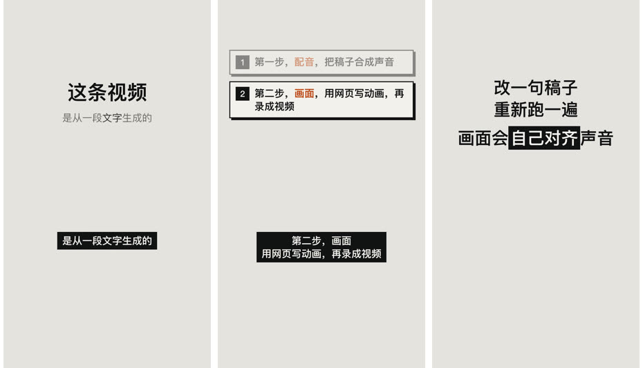

# AI 短视频工作流

**English → [README.md](README.md)**

在自己的电脑上，把一段口播稿做成抖音竖版成片（1080×1920，30 fps）：合成配音，用代码生成动画，字幕和关键词卡着说话的那一秒出现，自动检查，响度调到 −14 LUFS 交付。你只跟 Agent 说话，流水线由 Agent 去跑。

这个仓库的目标是：一个人，或者一个 Agent，读完它就能在一台空电脑上把整套东西搭起来。要开哪些账号、买什么、装什么、钥匙放哪、怎么出一条测试视频证明搭好了，都写在里面。在中国大陆也有一条不用翻墙的路线。

## 从这里开始

**如果你是 Agent**：读 [AGENTS.md](AGENTS.md)。

**如果你是人**：

1. 先在电脑上装好一个能干活的 Agent：[setup/00-agent.md](setup/00-agent.md)。在中国大陆看 [setup/china.md](setup/china.md)。
2. 把这个仓库下载到本地，在仓库文件夹里打开 Agent，对它说：「读 AGENTS.md，帮我把这台电脑配置好，装东西之前先问我。」
3. Agent 会检查电脑，告诉你要注册哪些账号，替你安装工具，最后渲染一条测试视频。

之后给 Agent 一个选题就行。它按 [skills/douyin-video/SKILL.md](skills/douyin-video/SKILL.md) 走：查资料、写稿、配音、做画面、检查、出片。你负责定稿、审片，自己发布。

## 需要准备什么

| | |
| --- | --- |
| 一台电脑 | macOS（实测过）、Linux（照着能装）、Windows（还没验证，见 [setup/platforms.md](setup/platforms.md)） |
| Agent 的模型 | Claude、ChatGPT，或国产的 MiniMax、智谱 GLM、Kimi、DeepSeek（[setup/00-agent.md](setup/00-agent.md)、[setup/china.md](setup/china.md)） |
| MiniMax 账号 | 配音和语音转写，按量付费就够（[setup/01-accounts.md](setup/01-accounts.md)） |
| 配乐（可选） | Google Lyria、国产音乐接口、自己的音乐文件，或者发布时在抖音里选曲库 |

在中国大陆，推荐用 Claude Code 接 MiniMax 的模型：Agent 和配音共用一个 MiniMax 账号。详见 [setup/china.md](setup/china.md)。

## 怎么做出来的

- **配音就是时钟。** 每页口播用 MiniMax 合成，再转写回文字对时间。字幕和 `[[关键词]]` 在说到它的那一秒出现。改一句稿子重新跑，后面的画面自动跟着挪。
- **画面是代码。** 每一页是 HTML 加 GSAP 动画，用 [HyperFrames](https://github.com/heygen-com/hyperframes) 一帧一帧录成视频，同样的输入每次出同样的片子。
- **自己检查自己。** HyperFrames 自带检查，每页截帧让 Agent 逐张看，两遍响度标准化到 −14 LUFS，最后把成片的声音转写回来跟稿子逐字对。

一条命令跑完：`python3 pipeline/make.py all episodes/<名字>`。加 `--placeholder` 可以不开任何账号，先出一条无声的预览。

## 改成你自己的

这个仓库只给流程和工具，不带任何人的风格和经验。你的经验在你自己的 fork 里慢慢攒：

- [config/video.json](config/video.json)：音色、语速、配色、字号、字幕位置、配乐音量、响度。每一项的说明见 [docs/customize.md](docs/customize.md)。
- `rules/rules.md`：你自己的规矩，比如怎么写稿、哪些词要换读法、画面上绝不能出现什么。从空模板 [rules.template.md](rules/rules.template.md) 开始，Agent 每期开工先读它，你过片之后它往里加。
- [pipeline/make.py](pipeline/make.py)：页面版式和配音服务商。配置改不到的，让 Agent 改这里。

## 不包含

- 发布。流水线不登录、不上传任何平台。
- 风格建议。你的风格写在 `rules/rules.md`。

## 致谢与许可

视频渲染用 [HyperFrames](https://github.com/heygen-com/hyperframes)（Apache-2.0）。页面动画用 [GSAP](https://gsap.com)，遵循它自己的免费许可，由 `npm install` 安装，不随仓库分发。配音和转写用 [MiniMax](https://github.com/MiniMax-AI/cli)。可选配乐用 Google Lyria。

本仓库采用 [MIT](LICENSE) 许可。
